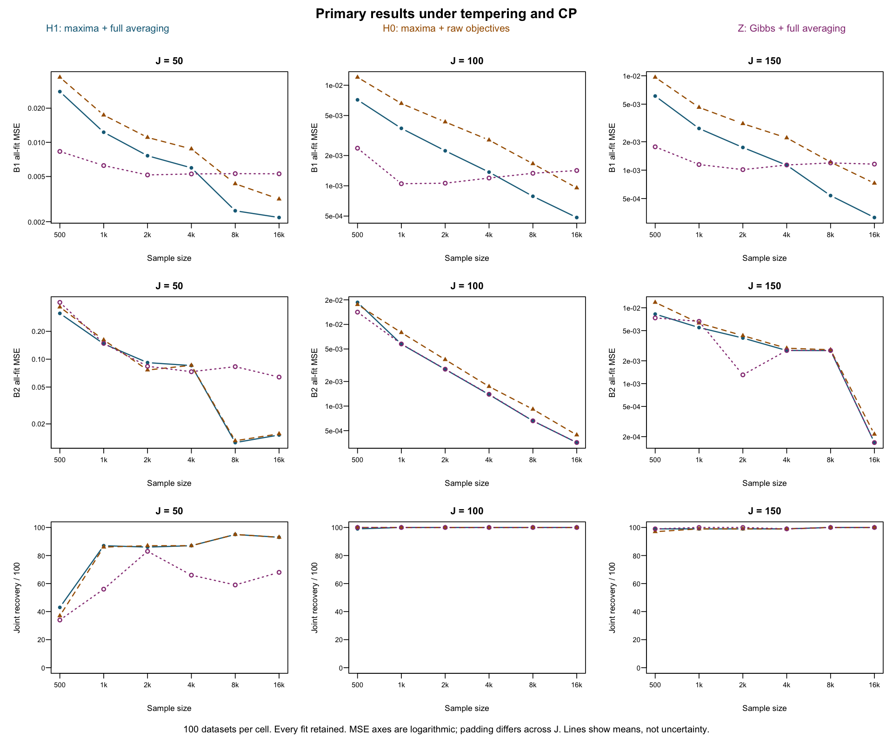

# Completed study evidence

These compact tables come from the read-only paper-evidence capture at **2026-10-29 01:20:03 UTC (October 28 evening, America/Chicago)**. [EVIDENCE_MANIFEST.json](../provenance/EVIDENCE_MANIFEST.json) records each source-relative path, byte size and SHA-256. Original tables were copied byte for byte; the original [AUDIT.json](AUDIT.json) records the independent endpoint reconciliation.

The primary study contains **21,600 fits**, 1,800 twelve-arm dataset cases, 216 J/n/arm cells and 100 datasets per cell. No fatal failures or missing MSE were reported. All **45 optimizer-flagged endpoints** remain included. Compact summaries are published here; bulk endpoint MAT files, 21,600-row fit tables and checkpoints are not.

| File | Meaning |
| --- | --- |
| `primary_all_settings.csv` | All four warmup settings, all-fit and conditional errors, selected denominators, flags and stopping counts |
| `primary_tempering_CP.csv` | Tempering+CP subset |
| `COMMON_SUMMARY.csv` | Original 216-cell summary used by `reproduce_tables.py` |
| `paired_tempering_CP.csv` | All-fit and both-correct paired contrasts, with eligible IDs |
| `matched_three_methods.csv` | Matching counts/cohorts across the three methods and sample sizes |
| `UNCERTAINTY.csv`, `PAIRED.csv` | Original Wilson/2,000-dataset bootstrap summaries and paired estimands |
| `optimizer_flagged_endpoints.csv` | Disclosure list, not an exclusion rule |

Under tempering+CP, Z has lower B1 MSE at n=500–2,000 across J=50/100/150; H1 has lower B1 MSE at n=8,000 and 16,000. The crossover at n=4,000 depends on J. H1 improves all-fit B1 MSE relative to H0 throughout this setting's grid. This descriptive evidence does not establish a universal sampler ranking or posterior mixing.

At n=16,000, joint dimension recovery for H1/H0/Z is 93/93/68 out of 100 for J50 and 100/100/100 for J100 and J150. Conditional MSE must be read alongside recovery and all-fit error. Method-specific correct-selection subsets differ; use the explicitly matched contrasts for paired comparisons. The all-six-n three-method matched cohort has only three cases for J50 and cannot support precise trend claims.

B2 errors are close on matched correctly selected H1/Z datasets, but the retained J150/n8000 spike prevents an unqualified monotone B2 claim. No posthoc exclusions were applied to these primary tables. Cap and stabilization overlap for 499 fits; their counts do not form a partition. A cap is not automatically a failed fit.

CPU includes serial-equivalent inherited prefix cost, and timing epochs differ. It is descriptive, not a controlled hardware benchmark. Intervals and matched comparisons have distinct eligible cohorts. Endpoint MSE does not demonstrate conditional-expectation accuracy, consistency, initialization stickiness or convergence. Ongoing mechanism diagnostics and posthoc sensitivities are outside this publication.

`python3 v2/reproduce_tables.py` verifies hashes and reconciles the published compact summary with the primary table. This does not recreate the original independent audit from endpoint records or regenerate bootstrap intervals; those require the full archived outcome data.

## Reproduced figures

- [Primary errors and dimension recovery](figures/primary_all_fit_errors_and_recovery.pdf)
- [Matched conditional errors](figures/matched_conditional_errors.pdf)
- [Runtime and cap](figures/runtime_and_cap.pdf)

PNG previews accompany the vector PDFs. These were regenerated from the published compact tables and visually checked.

